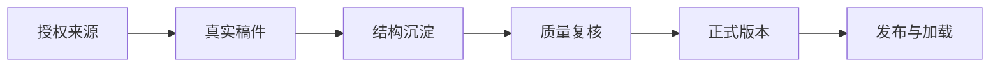

# 依旧沉淀

依旧沉淀是一个本地优先的**营销内容创作工作台**，主要服务抖音娱乐 / 泛娱乐营销号的口播稿、解说稿生产。

它解决的核心问题只有一个：

> 把一个已经由用户确定的选题，从研究、角度判断、素材筛选、写作结构，到完整成稿和风险审查，变成稳定可重复的内容生产工作流。

用户拥有最终选题权、角度选择权、素材选择权、结构选择权和最终修改权。AI 不替用户决定要写什么，只负责研究、整理、起草、审稿标注和局部改写。

项目不把标题、描述或用户手输文本伪装成"已提取稿件"。无法取得真实内容时，流程会明确停止，而不是继续生成看似可信的结果。

> 当前产品事实来源是 [docs/product-baseline.md](docs/product-baseline.md)。仓库中其他 v1 文档仅作历史保留。
>
> 最近一次更新说明见 [CHANGELOG.md](CHANGELOG.md)。

## 两个闭环

### A. 日常创作闭环（默认首页，高频）

```text
新建稿件
↓
选题 → 研究 → 角度 → 素材 → 结构 →（生成设置）→ 完整成稿 → 审稿 → 导出
```

每一篇稿件对应一个 `WritingProject`，每一步状态持久化，可以前后返回修改。

### B. 能力沉淀闭环（Skill 工厂，辅助资产）

```text
优秀视频 / 真人稿件
↓
链接 / 视频 / 字幕 / 文本
↓
提取 / 转写 → 结构分析 → 人工判断
↓
沉淀为结构资产 / 参考稿 → 必要时发布 Codex Skill
```

Skill 工厂（视频解析、转写、结构拆解、评测、发布、Codex Sync）保留全部现有能力，但它是创作闭环的供血方，**不阻塞普通写稿**。没有现成 Skill 时，写稿使用通用结构继续完成。

## 适合谁

- 每天需要把热点 / 选题变成抖音娱乐、泛娱乐口播稿的内容策划和文案。
- 需要把优秀真人稿件反向沉淀为可复用写作结构的内容团队。
- 想把模型连接、来源证据、人审和 Skill 发布放在同一个本地工作台管理的团队。

## 核心能力

| 能力 | 做什么 | 结果 |
| --- | --- | --- |
| 创作主线 | 选题输入 → 联网研究 → 角度选择 → 定向素材 → 结构匹配 → 完整成稿 | 可编辑的完整稿件 |
| 研究质量 | 区分已确认事实、存疑信息和观点，保留来源 | 可核查的 ResearchBrief |
| 素材控制 | 第二轮定向研究生成 MaterialCard，用户决定用不用 | 进入正文的 SelectedMaterials |
| 写作结构 | 按选题 + 角度 + 素材推荐结构，支持手动选择与通用结构 fallback | 可追溯的 SelectedStructure |
| 完整成稿 | 一次生成标题、完整口播、分镜建议、字幕节奏、评论引导、风险提示 | 无占位符的 GeneratedScript |
| 审稿 | AI 痕迹标注（annotation）+ 分阶段风险审查 + 选中文字局部改写 | 带批注的终稿 |
| 来源提取（Skill 工厂） | 接收抖音分享文案或 `v.douyin.com` 短链，优先使用本机浏览器会话提取公开视频 | 视频、音频、关键帧和可分析稿件 |
| 稿件校准（Skill 工厂） | 可选 FunASR 口播转写和 PaddleOCR 硬字幕识别 | 带来源和质量状态的真实稿件 |
| 结构沉淀（Skill 工厂） | 拆解钩子、推进、论证、情绪节奏、结尾、适用场景和不可用边界 | 可审核的写作结构资产 |
| 质量复核（Skill 工厂） | 记录来源证据、真实模型评测和人工主审结果 | 候选或正式版本 |
| 发布与加载（Skill 工厂） | 连接已有 GitHub 仓库、由应用创建新仓库，或仅保存在本机 | 版本化 Skill runtime 和动态安装命令 |

## 工作流

创作闭环（当前主流程）：


能力沉淀闭环（Skill 工厂）：



发布门禁只约束进入 Codex 的分发版本：

1. 至少 3 个授权来源案例，证明结构不是单个样本的偶然写法。
2. 真实模型发布评测通过，确认结构化输出可用。
3. 内容主审批准，明确适用范围、风险和复用边界。

发布始终由用户手动触发。沉淀、保存或主审不会自动推送到 GitHub，也不会阻塞普通写稿。

## 隐私与安全

- 开源仓库默认是空资产库，不包含真实 Skill、稿件、来源、评测报告、诊断记录或媒体文件。
- API Key 和可选抖音 Cookie 只保存到系统钥匙串；系统钥匙串不可用时，它们仅在当前服务进程内保存。
- 设置 API 不回显密钥。环境变量优先于本机设置，适合 Docker、CI 或管理员托管环境。
- GitHub Token 不会由应用保存。应用内创建或发布 GitHub Skill 仓库依赖用户已登录的 `gh` CLI。
- 仅处理你有权访问、使用和沉淀的来源内容。公开链接也可能因地区、作品权限或平台限制而无法下载；此时请停止并补充合法来源，不要绕过访问限制。

## 快速开始

### 前置条件

当前本机启动脚本以 macOS 或 Linux 的 `zsh` 和 `screen` 为基准。Windows 尚未作为受支持的启动环境验证。

- Python 3.14
- Node.js 24 或更新版本
- [uv](https://docs.astral.sh/uv/)
- `screen`
- `ffmpeg`（必需，用于本地媒体处理）
- 可选：`yt-dlp`、FunASR、PaddleOCR、GitHub CLI `gh`

macOS 可先安装基础依赖：

```bash
brew install ffmpeg screen
python3 -m pip install --user yt-dlp
```

### 安装并启动

```bash
git clone https://github.com/youfei0719/still-settling-workbench.git
cd still-settling-workbench

cp .env.example .env
cp .env.workbench.example .env.workbench.local

uv venv .venv --python 3.14
source .venv/bin/activate
uv sync --project backend --active --locked
npm ci

npm run workbench:start
```

打开 <http://127.0.0.1:5173/>。启动脚本会在后台分别运行 API 和前端；可用以下命令查看状态、日志和停止服务：

```bash
npm run workbench:status
npm run workbench:logs
npm run workbench:stop
```

### 手动启动

不使用 `screen` 时，在两个终端分别运行：

```bash
source .venv/bin/activate
python scripts/dev-workbench-api.py
```

```bash
npm run dev --workspace frontend -- --host 127.0.0.1
```

## 首次配置

进入工作台的"系统诊断 -> 首次配置"，按需要完成以下配置。

### 1. 模型连接

填写模型模式、API Base 和 API Key 后，点击"保存并拉取模型"。应用会请求兼容的 `/models` 接口，排除嵌入、音频、图像等非文本模型，并推荐一个适合中文结构化输出的候选模型。你仍可自行选择模型，并通过"测试模型连接"确认真实调用可用。

不使用外部模型时选择 `offline`，应用只使用本地确定性 fallback；需要强制真实模型时选择 `required`。

普通写稿不依赖 Skill 发布配置。以下两节只影响 Skill 工厂与团队分发。

### 2. Skill 发布项目（可选，高级）

选择一种发布方式：

- **连接已有 GitHub 仓库**：粘贴完整的 `https://github.com/owner/repository` 地址，应用会 clone 并校验 remote、分支和本机 Git 状态。
- **创建 GitHub 仓库**：填写名称和可见性。请先在终端完成 `gh auth login`，应用会用当前 GitHub 身份创建仓库并保存本机发布设置。
- **仅本地保存**：创建一个本地 Skill 仓库，不会连接或上传到 GitHub。

通过"验证发布"后，才可在"团队 Codex 同步"中手动发布正式 Skill。安装和更新命令会根据该用户实际配置的仓库地址动态生成。

### 3. 抖音会话与媒体能力（Skill 工厂）

默认优先使用本机 Chrome 会话解析公开链接。Cookie 是可选项，只在作品确实需要有效会话时填写。链接提取依赖 `yt-dlp`，也支持配置兼容的 `jiji262/douyin-downloader`；ASR 和 OCR 是独立可选模型，不会阻塞基础工作流。

## 推荐使用方式

### 日常写稿

1. 打开工作台，在"新建稿件"里输入你今天要写的选题，点击"开始研究"。
2. 确认研究结果：已确认事实、存疑信息和观点是否区分清楚。
3. 选择内容角度（或自定义角度）。
4. 查看角度定向研究产出的素材卡，勾选允许进入正文的材料。
5. 选择推荐写作结构，或使用通用结构。
6. 生成完整初稿，在编辑器中修改。
7. 查看 AI 痕迹标注，对问题句直接选中做局部改写；处理风险提示。
8. 导出 Markdown / JSON。

### 沉淀能力（Skill 工厂，低频）

1. 在"沉淀 Skill"粘贴完整抖音分享文案或短链。
2. 等待链接识别、媒体提取和真实稿件准备完成；失败时先根据诊断补齐合法来源或本机依赖。
3. 审阅结构拆解，确认它表达的是可迁移的写法能力，而不是逐句仿写来源内容。
4. 在"写作 Skill 库"持续补充同结构的授权来源，运行发布评测并完成主审。
5. 点击"检查并申请正式并同步 GitHub"，或选择仅本地发布。
6. 团队成员使用生成的安装命令加载最新正式版本；候选和已退役 Skill 不会进入稳定 runtime。

## 配置参考

`.env` 只保存通用本地应用配置。`.env.workbench.local` 用于本机工作台能力；两者都被 Git 忽略。

| 场景 | 配置项 |
| --- | --- |
| 模型 | `WORKBENCH_LLM_MODE`、`WORKBENCH_LLM_MODEL`、`WORKBENCH_LLM_API_BASE`、`WORKBENCH_LLM_API_KEY` |
| 数据目录 | `WORKBENCH_DATA_DIR`、`WORKBENCH_DB_MODE` |
| 视频提取 | `WORKBENCH_DOUYIN_DOWNLOADER_*`、`WORKBENCH_YTDLP_COOKIES_FROM_BROWSER` |
| ASR/OCR | `WORKBENCH_ASR_MODE`、`WORKBENCH_OCR_MODE`、`WORKBENCH_MODEL_WORKER_PYTHON` |
| 发布 | `DOUYIN_WRITING_SKILLS_REPO`、`DOUYIN_WRITING_SKILLS_REMOTE_URL`、`DOUYIN_WRITING_SKILLS_BRANCH` |

优先在界面的"首次配置"完成模型和发布设置。环境变量只适合自动化部署、CI 或需要由管理员统一管理配置的场景。

## 常见问题

### 链接识别成功但没有真实稿件

这表示系统已识别出链接，但没有取得足够可靠的视频内容。检查 `yt-dlp` 或下载器配置、公开可访问性、本机浏览器会话，以及 `ffmpeg` 是否可用。系统不会根据标题或描述猜测稿件。

### 没有现成写作结构还能写稿吗

可以。结构匹配是增强项：没有匹配到结构时使用通用写作骨架继续完成生成，不会因为 Skill 库为空而停住。

### 为什么不能立刻发布一个 Skill

单个爆款的表达很可能不可迁移。3 个授权来源、模型评测和主审分别验证"证据够不够""结构能否稳定执行""是否适合团队复用"。未通过门禁的候选仍可保存在本机继续完善，但不能进入公开稳定包。这属于 Skill 工厂流程，不影响日常写稿。

### API Key 会上传到 GitHub 吗

不会。界面输入的 API Key 和 Cookie 不写入仓库，也不会在接口响应中回显。请不要手动把真实凭据填入 `.env.example`、截图、Issue 或 Pull Request。

### GitHub 发布被拒绝

确认本机已安装 Git、`gh` 且 `gh auth status` 成功；本地 Skill 仓库必须干净，配置的 remote URL 和本机 `origin` 必须一致，发布分支必须存在。

## 验证与开发

```bash
# 前端类型检查与构建
npm run build --workspace frontend

# 后端单元测试
uv run --project backend pytest backend/unit_tests

# 本机依赖检查
npm run deps:workbench

# 公开发布前的脱敏检查
uv run --project backend python scripts/verify-open-source-release.py
```

贡献前请阅读 [CONTRIBUTING.md](CONTRIBUTING.md)。不要提交真实来源、媒体、Skill 资产、评测报告、API Key、Cookie 或本机路径。

## 项目结构

```text
backend/                 FastAPI API、提取链路、质量门禁和本机设置服务
frontend/                React 工作台
scripts/                 本机启动与开源发布检查
evals/workbench/         仅包含可公开的评测配置和提供方代码
docs/product-baseline.md 当前产品事实来源
.env.example             通用本机配置示例
.env.workbench.example   工作台能力配置示例
```

## 更新记录

- 2026-09-13：创作工作台 v2（Phase 1–4）—— 创作主线、联网研究与逐条来源、Angle 驱动的素材研究、
  基于已选素材的结构推荐、带证据追踪的完整成稿。详见 [CHANGELOG.md](CHANGELOG.md)。

## License

MIT。项目保留 FastAPI Full Stack Template 的上游版权声明，详见 [LICENSE](LICENSE)。
